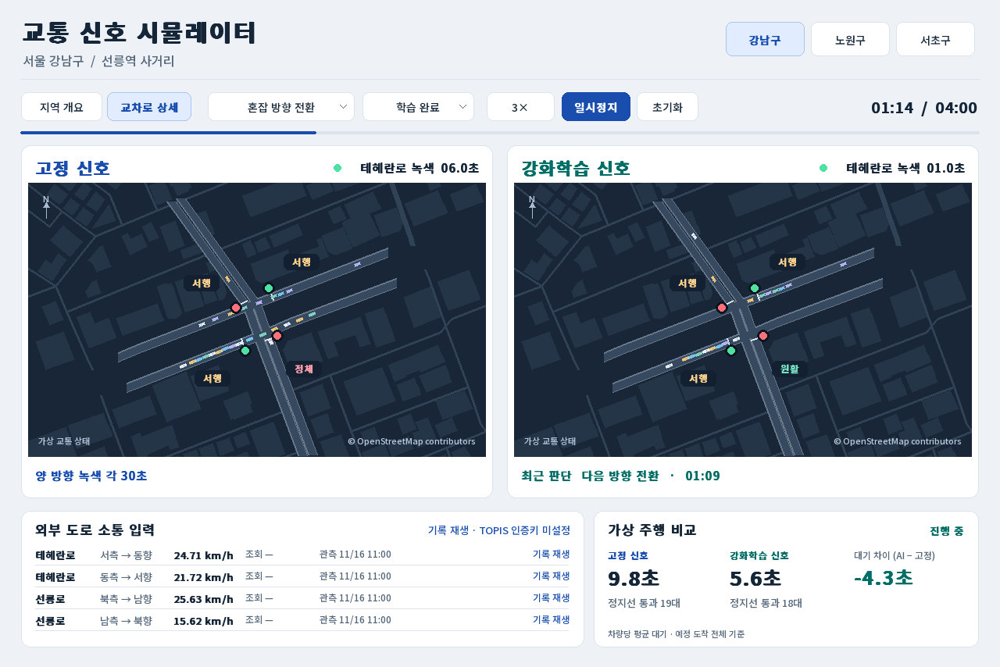

# 서울 교통 신호 시뮬레이터

실제 서울 도로 형태 위에서 **고정 신호**와 **Q-learning 신호**를 비교하는 Python/Pygame 프로젝트입니다. 선릉역 사거리와 태릉입구역 사거리에서 시연할 수 있습니다. 최초 실행은 선릉역의 TOPIS 통행속도 기록과 가상 차량 수요로 시작합니다.



## Windows에서 VS Code로 실행

1. ZIP을 풀고 VS Code의 **파일 → 폴더 열기**에서 `seoul-traffic` 폴더를 선택합니다. 터미널에서 `main.py`가 보이는 폴더로 이동합니다.
2. Python 3.10~3.13과 VS Code의 Microsoft **Python** 확장을 사용합니다. 여러 버전이 설치돼 있으면 **Python: Select Interpreter**에서 사용할 버전을 선택합니다.
3. VS Code PowerShell 터미널에서 실행합니다.

   ```powershell
   python -m pip install -r requirements.txt
   python main.py
   ```

   의존성을 설치한 뒤에는 **F5**로도 실행할 수 있습니다. 프로그램 실행과 저장 기록 또는 합성 예제 재생에는 인터넷이나 API 키가 필요 없습니다. 한국어 표시를 위해 재배포 가능한 Noto Sans KR 글꼴을 포함했습니다.

### 시연 조작

- 초기 화면에서 두 정책이 자동으로 시작합니다. 기본 `혼잡 방향 전환`은 시뮬레이션 88초에 주된 유입 방향이 바뀝니다. 기본 화면은 실제 1시간 간격의 속도 값도 시뮬레이션 16초 간격으로 자동 적용합니다. 기본 3배속으로 4분 시뮬레이션을 약 80초 동안 봅니다.
- **일시정지 / 실행**은 스페이스바로도 조작할 수 있습니다. **초기화**와 시나리오 변경은 같은 시드로 도착 목록을 다시 생성합니다. **학습 전 / 학습 중간 / 학습 완료**를 바꾸면 같은 입력에서 정책의 행동을 비교할 수 있습니다.
- 지역 버튼에서 강남구·노원구의 주변 도로 개요를 연 뒤 **교차로 상세**를 선택합니다. 서초구는 서초역·교대역 주변 지도와 서초중앙로 양방향의 과거 관측값을 제공합니다. 화면에 제공 범위를 표시합니다.
- 도로 위 색·문자는 가상 차량 상태입니다. 아래 **외부 도로 소통 입력**에 별도로 표시되는 속도·조회 시각·입력 모드를 확인합니다. **가상 주행 비교**는 두 정책의 누적 평균 대기와 정지선 통과를 보여줍니다.
- 시연을 끝까지 실행하면 `runtime/results/`에 실제 적용한 입력, AI 결정, 기준 정책 및 AI 지표가 저장됩니다.

## 도로와 데이터

| 지역 및 후보 | 직진 2그룹 | 조사 자료와 선정 근거 |
| --- | --- | --- |
| 강남구 선릉역 사거리 · 기본 지점 | 테헤란로 / 선릉로 | D-42 테헤란로(선릉역) 관측이 교차로 동측의 같은 진행 방향을 직접 뒷받침합니다. 2024년 보고서의 가용 월과 접근 방향을 확인할 수 있어 첫 지점으로 선택했습니다. |
| 노원구 태릉입구역 사거리 · 두 번째 지점 | 화랑로 / 동일로 | 화랑로 D-10 화랑대역에서 두 방향의 시간대별 통과량을 확보했습니다. 교차로와 별도 지점의 관측인 만큼 동일로의 D-13 노원역은 참고 표기로 두고, 상세 시뮬레이션에는 D-10만 사용했습니다. |
| 서초구 · 지역 개요 | 서초역·교대역 주변 도로 | D-37 반포대로(서초역) 조사지점을 표기했습니다. 서초중앙로 양방향의 보관 관측값을 표시합니다. 상세 시뮬레이션은 등록 전입니다. |

지도는 OpenStreetMap의 [선릉역 사거리](https://www.openstreetmap.org/#map=17/37.504517/127.049015), [태릉입구역 사거리](https://www.openstreetmap.org/#map=17/37.617631/127.075662), [서초역·교대역 주변](https://www.openstreetmap.org/#map=16/37.4918/127.0137) 도로·건물 형상을 사용합니다. OSM API의 좌표를 국소 미터 좌표로 변환하고, 도로 진행선과 정지선을 수업용으로 단순화했습니다. 지도 데이터인 `data/maps/*.json`의 OSM 파생 부분은 ODbL 1.0을 따릅니다. 상세 지도 JSON의 `osm_way_ids`에서 시뮬레이션 경로의 기반 도로를 확인할 수 있습니다. [© OpenStreetMap contributors](https://www.openstreetmap.org/copyright) · [ODbL 1.0](https://opendatacommons.org/licenses/odbl/1-0/)

출근·낮·퇴근은 각각 평일 08–09시, 12–13시, 18–19시를 참고합니다. 아래의 `대/시`는 보고서에서 읽은 해당 시간대 관측입니다. 앱은 관측 대수를 보고서의 차로 수로 나누고 반올림해 단일 가상 차로의 도착률로 사용합니다. D-42는 2024년 12월의 가용 관측을 사용했습니다. D-10은 화랑대역 관측을 같은 도로의 상류·하류 대리값으로 사용했습니다. 나머지 접근로의 도착률과 **혼잡 방향 전환** 시나리오의 전체 입력은 가정값입니다. 설정값과 페이지 번호는 `data/traffic_volume_sources.json`에 있습니다. [서울시 교통량 정보 및 2024년 보고서](https://data.seoul.go.kr/dataList/OA-15064/L/1/datasetView.do) · [TOPIS 교통량 조사지점](https://topis.seoul.go.kr/refRoom/openRefRoom_2.do?tab=trafficvolDaily) · [서울시 교통량 이력 API](https://data.seoul.go.kr/dataList/OA-13316/A/1/datasetView.do)

| 시뮬레이션 접근로 | 보고서 관측 방향 | 차로 | 출근 | 낮 | 퇴근 |
| --- | --- | ---: | ---: | ---: | ---: |
| 선릉역 동측 | D-42 포스코사거리 → 선릉역 | 4 | 2,276 | 2,252 | 1,953 |
| 태릉입구역 동측 | D-10 화랑대역 → 태릉입구역 | 5 | 1,891 | 1,697 | 1,955 |
| 태릉입구역 서측 | D-10 태릉입구역 → 화랑대역 | 3 | 1,457 | 1,779 | 1,481 |

### TOPIS 연결과 기록 재생

두 교차로 각 4개 접근로의 도로명·시점·종점·진행 방향을 2020년 3월 서울시 서비스 링크 매핑, 링크 좌표 및 2020년 11월 TOPIS 속도 자료에서 대조했습니다. JSON에는 서비스 링크 ID를 기록했습니다. 라이브 호출 전 최신 서비스 링크 정보에서 변경 여부를 확인할 수 있습니다. 현재 인증키로 각 링크를 호출하는 검증은 남아 있습니다. [서울시 소통 돌발 링크 정보](https://data.seoul.go.kr/dataList/OA-13310/A/1/datasetView.do) · [T Data 서울시 서비스링크](https://t-data.seoul.go.kr/dataprovide/trafficdataviewfile.do?data_id=1) · [SeoulTrafficData 보관본](https://github.com/cdsnlab/SeoulTrafficData)

| 지점 | 서측 접근 | 동측 접근 | 북측 접근 | 남측 접근 |
| --- | --- | --- | --- | --- |
| 선릉역 | 1220026100 | 1220026800 | 1220027600 | 1220025900 |
| 태릉입구역 | 1100007800 | 1100007900 | 1100000300 | 1060006000 |

오프라인 기록은 서울시 TOPIS의 2020-11-16과 2020-11-18 시간대별 통행속도를 공개 보관본에서 발췌한 것입니다. 관측 시각은 CSV의 KST 날짜와 시간 열 표기를 사용하며, 원본 조회 시각은 비워 두었습니다. 11월 16일 기록을 기본 시연과 추가 학습에 사용했고 11월 18일 기록을 별도 평가에 사용했습니다. `data/recordings`의 역사 기록과 서초구 관측 구간 좌표는 해당 보관본의 GPL-3.0 조건으로 제공합니다. [서울시 통행속도 보고서](https://news.seoul.go.kr/traffic/archives/417) · [2020년 11월 원본 보관 CSV](https://github.com/cdsnlab/SeoulTrafficData/blob/main/csv/202011.csv)

Windows PowerShell에서 현재 터미널에만 키를 설정한 뒤 실행합니다. 키를 입력하는 동안 화면에 표시되지 않습니다.

```powershell
$env:SEOUL_OPEN_API_KEY = [Net.NetworkCredential]::new('', (Read-Host '서울 열린데이터광장 인증키' -AsSecureString)).Password
python main.py --mode live --poll-seconds 60
Remove-Item Env:SEOUL_OPEN_API_KEY
```

- 명세의 HTTP 경로는 `/{KEY}/xml/TrafficInfo/1/5/{LINK_ID}`입니다. 공식 HTTP 경로는 전송을 암호화하지 않습니다. 앱은 키와 전체 요청 URL을 화면이나 로그에 출력하지 않습니다.
- `LINK_ID`, `PRCS_SPD`(km/h로 처리), `PRCS_TRV_TIME`(있는 경우 초로 처리)를 읽습니다. 웹 명세에는 속도·여행시간 필드의 단위가 따로 적혀 있지 않아 속도 단위는 TOPIS 일반도로 표기와 일치시키고, 여행시간은 초 단위로 해석합니다. 원본 관측 시각 필드는 해당 명세에 없습니다. 응답에 파싱 가능한 관측 시각이 있으면 `observed_at`으로 저장하며, 별개로 KST 조회 시각을 `fetched_at`에 저장합니다.
- 샘플 키는 요청당 최대 5건, 일반 명세는 요청당 최대 1,000건입니다. 이 앱은 접근로별 한 건을 요청합니다. 앱의 기본 조회 간격은 실제 시간 60초입니다. 공식 자료는 원본을 실시간으로 기술하며 동일 값이 연속 조회될 수 있습니다.
- 별도 스레드에서 링크별 5초 타임아웃으로 조회합니다. 실패하거나 값의 나이가 기준을 넘으면 마지막 유효값을 표시하고 `오래됨`을 붙입니다. 유효값이 없으면 시나리오에 연결된 `기록 재생`이나 `합성 예제`가 계속 동작합니다. 유효한 조회는 `runtime/logs/<지점>.jsonl`에 추가됩니다. [TrafficInfo 명세](https://data.seoul.go.kr/dataList/openApiView.do?infId=OA-13291&srvType=A) · [TOPIS 소통정보](https://topis.seoul.go.kr/map/openTrafficMap.do)
- 저장 기록은 조회 시각 또는 보관된 관측 시각 간격대로 자동 재생됩니다. 대체 기록의 속도는 각 방향의 가상 이동에만 적용됩니다. 아래 예제의 날짜 및 속도는 합성값으로, 화면에 **기록 재생(합성)**으로 표시됩니다.

```powershell
python main.py --site taereung --mode offline
python main.py --mode synthetic
python main.py --recording data/recordings/seolleung_example.jsonl
```

실제 기록을 재생할 때는 `--recording runtime/logs/seolleung.jsonl`을 사용합니다. 마지막 기록 시각이 시연 시간 안에 들도록 `--duration`(초)이나 `--recording-compression`(예: 5이면 실제 60초 간격을 시뮬레이션 12초로 적용)을 지정할 수 있습니다.

## 교통 환경과 학습 모델

- 엔진은 화면 갱신과 별개로 0.25초마다 동작합니다. 같은 시드, 입력, 시뮬레이션 시간에서 만들어진 예정 도착 목록을 모든 정책에 공유합니다. 입구 여유가 없으면 FIFO 진입 대기열에 차량을 남깁니다.
- 방향별 단일 직진 차로와 7m의 최소 차량 간격으로 구성했습니다. 회전·보행·차선 변경은 범위에서 제외했습니다. 황색과 전적색은 신규 통과를 막고 이미 정지선을 넘은 차량은 계속 나갑니다.
- 신호 순서는 녹색 → 황색 3초 → 전적색 1초 → 상대 방향 녹색입니다. 최소 녹색은 10초, 최대 60초입니다. 55초에는 전환과 5초 연장이 가능하고, 60초에서는 제어기가 자동 전환합니다. 온전히 관찰한 적색은 전적색 1초 + 상대 방향 녹색 10~60초 + 상대 방향 황색 3초 + 전적색 1초로 15~65초입니다.
- 외부 속도를 3.6으로 나누고 설정된 하·상한으로 제한해 접근로 목표 속도를 구합니다. 같은 도착률에서 느린 차량이 도로에 더 오래 남을 수 있습니다. 도로 색·문자는 그 접근로의 가상 대기열과 움직이는 차량의 평균 속도를 사용합니다.
- 고정 정책의 양 방향 녹색은 각 30초입니다. 대기열 정책은 상대편 대기열이 더 길면 전환하고, 그렇지 않으면 5초 연장을 요청합니다. 세 정책이 같은 공통 제어기를 사용합니다.
- Q-learning의 상태는 양 방향 가상 대기열 구간, 녹색 방향, 5초 단위 녹색 경과입니다. 대기열 구간은 0, 1–2, 3–5, 6–11, 12–23, 24대 이상입니다. 행동은 즉시 전환, 5초 연장, 10초 연장이며 실제 녹색 경과로 허용 여부를 검증합니다.
- 결정 사이의 각 0.25초 스텝에서 `-대기 차량 수 × 0.25초`를 보상으로 더합니다. 황색·전적색·다음 방향의 최소 녹색에서 발생한 대기도 포함됩니다. 학습은 `Σ gamma^i × reward_i + gamma^k × max(Q(next, 허용 행동))`으로 갱신합니다. `k`는 지난 스텝 수이며 종료에서는 다음 가치를 0으로 둡니다. 스텝 할인율은 0.998입니다.
- 학습에서만 epsilon-greedy를 사용합니다. 저장 모델을 재생할 때 동률이면 허용된 대기열 규칙의 행동을 먼저 사용하고, 그 행동이 최대값 집합 밖에 있으면 전환·5초·10초 순서로 결정합니다. 초기 빈 Q-table과 처음 보는 상태에서는 이 규칙으로 재현 가능한 선택을 합니다.

### 학습과 평가 명령

```powershell
python main.py train --site seolleung --episodes 500 --checkpoint-every 25
python main.py evaluate --site seolleung --seeds 8101 8102 8103 8104 8105
python main.py train --site seolleung --scenario shift --episodes 80 --resume models/seolleung/final.json --recording data/recordings/seolleung_20201116.jsonl --recording-compression 225 --output runtime/models/seolleung-extra
python main.py evaluate --site seolleung --scenario shift --models models/seolleung/final.json runtime/models/seolleung-extra/final.json --recording data/recordings/seolleung_20201118.jsonl --recording-compression 225 --output runtime/extra-comparison.json
python main.py --snapshot runtime/models/seolleung-extra/final.json
```

배포본에 있는 추가 학습 모델은 `models/seolleung_archive/final.json`입니다. 실제 라이브 기록도 동일한 명령의 `--recording`에 넣을 수 있습니다. 추가 학습은 새 폴더에 스냅샷을 생성하며, 평가 명령은 두 모델에 같은 입력을 적용합니다. 라이브 표시 중에는 모델을 업데이트하지 않습니다. `learning_curve.json`에는 초기, 중간, 완료 및 지정 간격의 검증 지표가 저장됩니다. 기본 모델은 지점별 500회, 선릉역 기록 모델은 별도 80회를 학습했습니다. 학습 시드는 2026입니다. 학습 에피소드별 도착 시드, 입력 시나리오, 신호 설정, 학습률, 할인율은 모델 메타데이터에 있습니다.

### 평가 결과

기본 평가에는 4개 시나리오와 학습·검증에 사용하지 않은 5개 차량 도착 시드를 사용했습니다. 각 지점에서 240초 실험을 20회씩 평가한 차량당 평균 대기입니다. 정지선 통과 대수는 아래에 함께 표시했습니다. 초기 Q-table은 비어 있어서 동률 규칙으로 대기열 정책과 같은 결과가 나왔습니다.

| 지점 | 고정 신호 | 대기열 규칙 | 학습 전 | 학습 중간 | 학습 완료 |
| --- | ---: | ---: | ---: | ---: | ---: |
| 선릉역 | 10.97초 / 105.8대 | 6.49초 / 105.8대 | 6.49초 / 105.8대 | 9.23초 / 104.8대 | 8.15초 / 105.0대 |
| 태릉입구역 | 11.12초 / 103.5대 | 6.35초 / 104.8대 | 6.35초 / 104.8대 | 10.15초 / 101.8대 | 8.17초 / 103.7대 |

2020-11-18의 실제 속도 기록과 다섯 가지 가상 도착 시드를 사용한 별도 240초 평가도 저장했습니다.

| 지점 | 고정 신호 평균 대기 | 대기열 규칙 | 기본 Q-learning | 기록 추가 학습 |
| --- | ---: | ---: | ---: | ---: |
| 선릉역 | 11.30초 | 5.95초 | 7.75초 | 14.53초 |
| 태릉입구역 | 13.27초 | 9.02초 | 14.57초 | — |

기본 평가에서는 두 지점 모두 대기열 규칙의 평균 대기시간이 가장 짧았습니다. 선릉역에서 추가 학습한 모델은 11월 18일 기록에서 기본 모델보다 대기가 길었습니다. `results/*_heldout_topis.json`에 실험별 지표가 있습니다.

차량당 평균 대기시간은 모든 예정 도착 차량을 대상으로 계산합니다. 입구 바깥 진입 대기와 정지선 통과 전 0.5m/s 미만으로 움직인 시간을 종료 시점까지 셉니다. 정지선 통과, 지도 경로 완료, 지도 위에 남은 차량, 지도 위 대기열, 입구 밖 진입 대기를 각각 저장했습니다. 실험 시나리오별 원본, 방향별 최대 누적 대기, 총 차량·초는 `models/<지점>/evaluation.json`에 있습니다.

## 수업에서 설명할 파일

| 수업 개념 | 실제 사용 |
| --- | --- |
| 함수와 반복문 | `traffic/scenario.py`의 예정 도착표 생성, `traffic/experiment.py`의 반복 학습 및 평가 |
| 클래스 | `Signal`의 단계 관리, `Simulation`과 `Lane`의 차량 상태, `QPolicy`의 정책, `Dashboard`의 화면 |
| 모듈 | `traffic/config.py`, `signals.py`, `engine.py`, `policy.py`, `observations.py`, `ui.py` |
| 자료구조 | 차량과 진입 FIFO는 `deque`, Q-table과 접근로 색인에는 딕셔너리, 좌표와 예정 입력에는 튜플 |
| 파일 입출력 | `config.py`의 JSON, `observations.py`의 JSONL, `policy.py`의 Q-table 저장·로드 |
| 지역 확장 | `data/regions.json`에 지점을 등록하고 지도·신호·유입률·링크·모델 경로를 별도 JSON으로 설정 |

## 테스트 환경과 확인 범위

```powershell
python -m unittest discover -s tests -v
```

- Linux의 Python 3.12와 Pygame-ce 2.5.6에서 자동 테스트 13개를 통과했습니다. 두 상세 지도의 렌더링, 지역 전환, 황색·전적색, 예정 차량 공유, 화면 없는 학습·모델 비교, 시연 종료 결과 저장을 확인했습니다.
- 공식 TrafficInfo 샘플 URL을 공개 샘플 키로 호출했으나 이 환경에서는 응답을 받지 못했습니다. 공식 명세를 따르는 합성 XML로 파싱과 실패 처리를 검증했습니다. 사용자의 실제 인증키 호출은 확인 전입니다.
- Windows x64용 Python 3.12의 Pygame-ce 설치 휠을 확인했습니다. Windows 자체에서의 직접 시연과 VS Code F5 실행은 확인 전입니다.


Python과 Pygame만 설치해 실행할 수 있습니다. `assets/OFL.txt`는 포함된 [Noto Sans KR 글꼴](https://github.com/google/fonts/tree/main/ofl/notosanskr)의 라이선스입니다.
